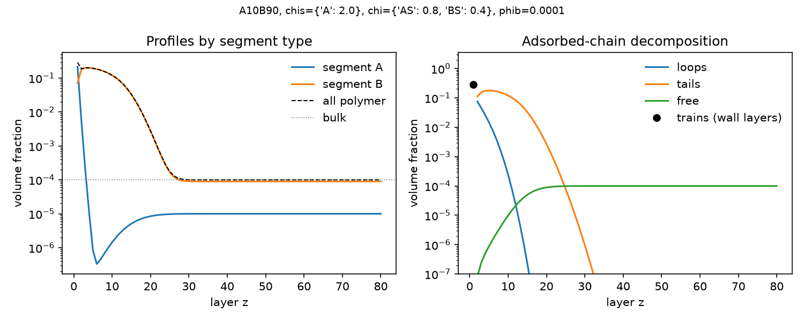
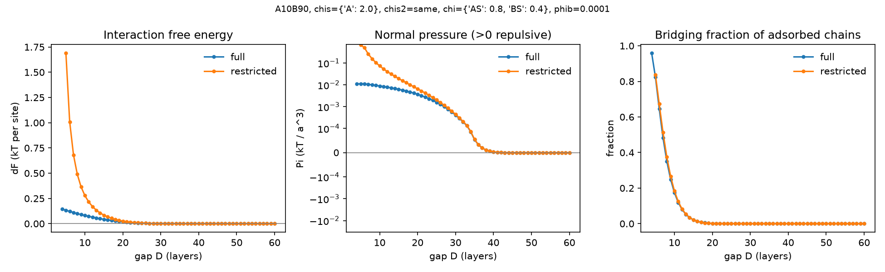
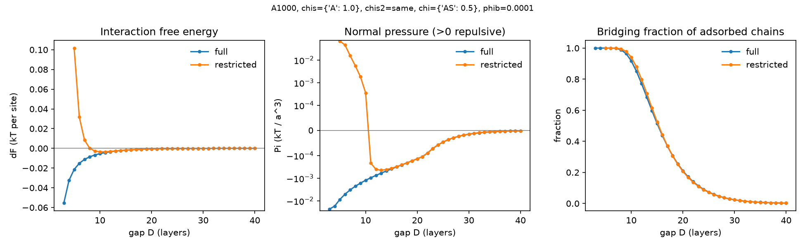

# sf1d

A small, tested implementation of 1D **Scheutjens–Fleer self-consistent field theory**
for polymer adsorption from solution: on one flat wall, or between two parallel walls.
It is meant as an equilibrium reference for molecular simulations of adsorbed
polymer layers, such as polymethacrylate friction modifiers on oxide surfaces.

- Linear copolymers with any block sequence (`A10B90`, `A1B9A1B9...`) in a monomeric solvent
- Flory–Huggins interactions and per-segment, per-wall adsorption energies
- Density profiles split into trains, loops, tails and free chains
- Grand potential and interfacial tension
- Two walls: bridging chains, interaction free energy ΔF(D) and normal pressure Π(D),
  in full equilibrium (chains exchange with the bulk) or restricted equilibrium
  (fixed adsorbed amount)
- Robust damped-Newton solver; dependencies are only NumPy and SciPy

## Install

```bash
pip install -e ".[plot,test]"     # plot = matplotlib, test = pytest
```

## Quick start

```bash
# Anchor-buoy copolymer on one wall
sf1d --seq A10B90 --chis A=2.0 --chi AS=0.8 --chi BS=0.4 --phib 1e-4 --M 80 --out run --plot

# Same polymer between two walls, compressed from D = 60 to 4 layers
sf1d --seq A10B90 --chis A=2.0 --chi AS=0.8 --chi BS=0.4 --phib 1e-4 \
     --scan 4 60 --mode both --out gap --plot
```

```python
from sf1d import SF1D

m = SF1D("A10B90", chis={"A": 2.0}, chi={"AS": 0.8, "BS": 0.4}, phib=1e-4, M=80).solve()
summary, profiles = m.analyse()
```

See [docs/usage.md](docs/usage.md) for every option and output column, and
[docs/theory.md](docs/theory.md) for the model, equations, solver and limitations.

## Examples

`examples/run_all.sh` regenerates everything in [`examples/output/`](examples/output/)
(about 1 min). All four use lattice units and kT.

**1. Anchor–buoy copolymer on one wall.** A10B90 with strongly adsorbing, poorly
solvated anchors (χs_A = 2, χ_AS = 0.8) and a moderately solvated buoy (χ_BS = 0.4).
The anchors stay within three layers of the wall. The buoys form a brush-like layer
about 25 layers thick, and 79 % of adsorbed segments are in tails.



**2. Anchor placement.** The same 10 % anchor content, spread out as (A1B9)×10,
adsorbs about 700 times less than the A10B90 block. The average adsorption energy per
segment is then barely above critical (`block_vs_distributed.json`).

**3. Two walls, anchor–buoy layers.** The interaction is purely repulsive, starting at
D ≈ 38, about twice the layer thickness. In full equilibrium, chains are expelled and
the pressure levels off near 0.01 kT/a³. With the amount frozen (restricted), it rises
to about 0.7 kT/a³ at D = 5. Bridging appears only below D ≈ 15.



**4. Validation: homopolymer between two walls.** N = 1000, χs = 1, χ = 0.5. The scan
reproduces the trends of Scheutjens & Fleer (1985): attraction at all gaps in full
equilibrium; in restricted equilibrium, a weak bridging minimum near D ≈ 10 and steep
repulsion below D ≈ 8.



## Tests

```bash
pytest
```

The tests compare against exact results and thermodynamic identities:

- monomer adsorption and interfacial tension (exact Langmuir-type results)
- the critical adsorption energy χs_c = ln(6/5), and its approach with chain length
- bulk recovery and incompressibility
- stationarity of the free energy (finite-difference derivatives with respect to χs and χ)
- distant walls giving 2γ, and restricted equilibrium reproducing full equilibrium
- consistency of the train/loop/tail decomposition and the bridge count
- the qualitative homopolymer gap-scan trends of Scheutjens & Fleer (1985)

## Scope and limitations

This is mean-field, equilibrium, lattice theory. It gets trends and adsorbed amounts
right but not good-solvent scaling exponents. It assumes the layer has equilibrated,
which strongly adsorbing polymers may not do (O'Shaughnessy & Vavylonis 2003). It
treats every species as one lattice site, and it gives no dynamics or friction. See
[docs/theory.md](docs/theory.md#limitations).

## License

MIT
