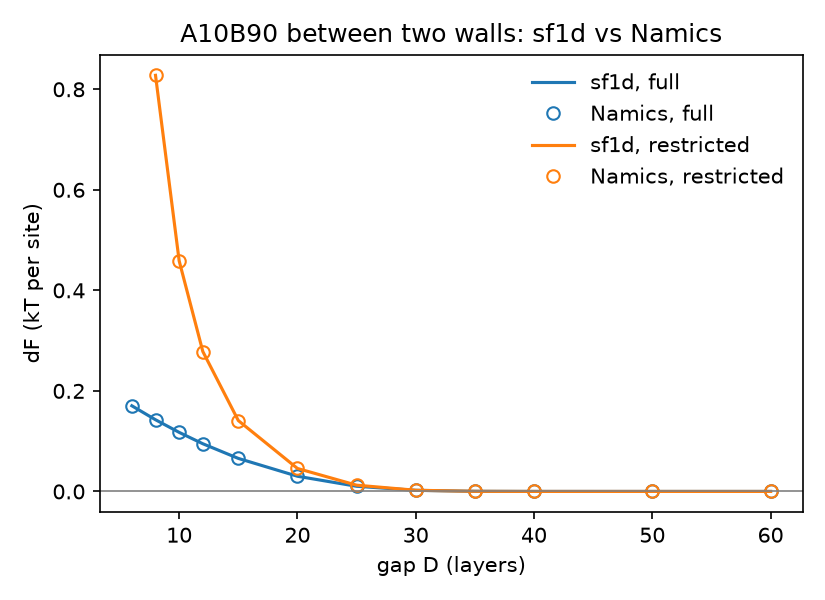

# Cross-check against Namics

[Namics](https://github.com/leermakers/Namics) is the Scheutjens–Fleer SCF code from
F. A. M. Leermakers' group (Wageningen), successor to sfbox. It handles branched
molecules, combs, curved and multi-gradient geometries, so it is the tool of choice
beyond what sf1d covers. This directory checks that sf1d and Namics solve the same
model for the cases sf1d can do.

## Running

```bash
git clone https://github.com/leermakers/Namics.git && (cd Namics && make)
python compare.py /path/to/Namics/bin/namics        # writes results.csv, gap_comparison.*
NAMICS=/path/to/Namics/bin/namics pytest             # from the repo root: adds 6 tests
```

Tested with Namics commit `5229a81` (28 Oct 2026), built with g++ 13.3 using the
default Makefile (CPU, C++14).

## Parameter mapping

| sf1d | Namics |
|---|---|
| layers `z = 1..M`, `--M` | `lat : flat : n_layers : M` (simple cubic, planar, 1 gradient) |
| wall at z = 0 | `lowerbound : surface` + frozen segment `Si` with `frozen_range : lowerbound` |
| second wall (`--walls 2`) | `upperbound : surface` + frozen `Si2` with `frozen_range : upperbound` |
| one wall, mirror at M+1 | `upperbound : mirror` (default) |
| solvent `S` | monomeric molecule, `freedom : solvent` |
| `--chi AS=v` | `mon : A : chi_W : v` |
| `--chis A=v` (Silberberg χs) | `mon : A : chi_Si : −6v` (χs = −λ₁(χ_A,Si − χ_W,Si), λ₁ = 1/6) |
| `--phib` | `mol : pol : freedom : free`, `phibulk` |
| `--theta` | `mol : pol : freedom : restricted`, `theta` |
| Ω (one wall: γ) | `sys : NN : grand_potential` |
| restricted A | `free_energy − n_W μ_W(reservoir) − n_pol μ_pol(reservoir)` (see below) |

`compare.py` generates the Namics inputs (`inputs/`) from the same case definitions
it passes to sf1d. Raw Namics output is in `output/`.

## Results

`results.csv` (single cases) and `gap_comparison.csv` (gap scan). Profiles φ_x(z) agree
to ≤ 3e-11 in every case; adsorbed amounts and free energies to ~1e-11.

| Case | max \|Δφ\| | θ | free energy |
|---|---|---|---|
| homopolymer N=100, χs=1, athermal | 2e-12 | 0.610725 | −0.163646 |
| homopolymer N=100, χs=1, χ=0.5 | 7e-13 | 1.131281 | −0.354659 |
| A10B90, χs_A=2, χ_AS=0.8, χ_BS=0.4, one wall | 1e-12 | 2.694632 | −0.114419 |
| same, two walls, D = 20 | 7e-12 | 4.282739 | −0.198625 |
| same, D = 30, inert second wall | 2e-12 | 2.689276 | −0.114415 |
| same, D = 10, restricted (amount of D = 40) | 4e-12 | 5.375938 | +0.228903 |



ΔF(D) agrees to ≤ 4e-11 at every gap in both modes. At D = 6 in restricted equilibrium
(φ ≈ 0.9 in the gap), Namics stops with a negative solvent bulk fraction, while sf1d
converges.

## What the comparison turned up

1. **The χs convention in sf1d 0.1.0 was not the Silberberg one.** sf1d 0.1.0 counted a
   wall's neighbour slot as bulk in the mixing term; Namics, like the original SF model,
   leaves it empty. In an athermal solvent the two coincide. With χ ≠ 0, the same χs
   number gave 4–17 % less adsorbed polymer in sf1d 0.1.0 than in Namics. sf1d 0.2.0
   uses the standard convention; the old behaviour corresponds to shifting χs by
   −λ₁(Σ_y χ_xy φ_y^b − Σ_y χ_Sy φ_y^b).
2. **Restricted-equilibrium free energies need a common reference.** In restricted
   mode Namics derives the bulk from the restricted amount (its effective polymer bulk
   fraction reached 0.42 at D = 10 in the anchor–buoy scan), so its `free_energy` is
   referenced to a composition that changes with D. For a slit whose solvent stays in
   exchange with the real bath, subtract n_W μ_W and n_pol μ_pol evaluated at the
   reservoir. Here, they are taken from a full-equilibrium run at the same gap, placed
   before the restricted run in the same input. Using raw `free_energy` differences
   instead gives errors of 2–5e-5 kT per site in ΔF(D) for this scan.
3. **Namics needs a previous result as initial guess for compressed restricted layers.**
   Its default guess fails with a negative solvent bulk fraction; `compare.py` solves
   full equilibrium first and switches the polymer to `restricted` with
   `initial_guess : previous_result`. With several `start` blocks, profile files are
   numbered (`<name>_1.pro`, `<name>_2.pro`) and the `.kal` file gets one row per run.
4. **Two sf1d bugs surfaced along the way, both fixed in 0.2.0.** Building the cases
   exposed a crash when no surface parameters are given. The stronger adsorption under
   the corrected convention exposed an overflow of the chain partition function in
   restricted mode for long chains (the N = 1000 example); propagators are now rescaled.
